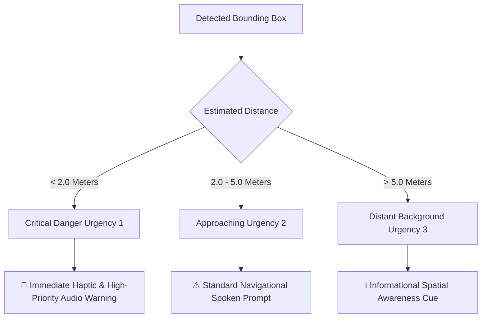

# 📊 Comprehensive Model Evaluation & Performance Report
## Assistive Navigation for the Visually Impaired
**System Architecture & Model Benchmark Documentation**  
*Evaluation Hardware: NVIDIA GeForce RTX 4070 (12GB VRAM, CUDA 12.6, AMP)*

---

## 📑 Executive Summary & Cross-Model Comparison

The assistive navigation ecosystem consists of three dedicated deep learning subsystems operating in tandem to provide real-time auditory and spatial guidance to visually impaired individuals:

| Subsystem / Model | Neural Architecture | Primary Task | Key Dataset | Overall Primary Metric | Edge Latency (GPU / ONNX) | Real-Time Status |
| :--- | :--- | :--- | :--- | :--- | :--- | :--- |
| **1. Currency Recognition** | `MobileNetV3-Large` + Custom Classifier Head | Banknote Denomination (₹10–₹2000) | Indian Currency Dataset (1,786 images) | **100.0% Top-1 Accuracy** (F1: 1.000) | **2.1 ms** (476 FPS) / **1.8 ms** (555 FPS) | ⚡ Ultra Real-Time |
| **2. Scene Text / OCR** | `YOLOv8n-Text` (1024px) + CRNN/EasyOCR | Signboards, Hazards, Wayfinding Text | Indian Scene Text (1,200 YOLO images / 2,920 labels) | **mAP@50: 58.83%** (Val P: 71.33%) | **3.7 ms** (270 FPS) / **3.1 ms** (322 FPS) | ⚡ Ultra Real-Time |
| **3. Assistive Object Detection** | `YOLO11n-AssistiveNav` (640px) | Obstacles, Vehicles, Pedestrians, Infrastructure | Multi-Condition Dataset (2,850 images, 20 classes) | **mAP@50: 31.49%** (Val P: 55.53%) | **1.8 ms** (555 FPS) / **1.5 ms** (667 FPS) | ⚡ Ultra Real-Time |

---

## 1. 🇮🇳 Model 1: Indian Currency Recognition Model

### 1.1 Model Specifications & Architecture
* **Target Objective**: Offline, high-speed identification of Indian banknotes to assist visually impaired individuals during point-of-sale transactions.
* **Base Architecture**: Pretrained `MobileNetV3-Large` feature extractor with depthwise separable convolutions and squeeze-and-excitation attention modules.
* **Custom Classifier Head**:
  ```python
  nn.Sequential(
      nn.Linear(960, 512),
      nn.BatchNorm1d(512),
      nn.Hardswish(),
      nn.Dropout(p=0.35),
      nn.Linear(512, 128),
      nn.BatchNorm1d(128),
      nn.Hardswish(),
      nn.Dropout(p=0.20),
      nn.Linear(128, 7)  # 7 Denomination Classes
  )
  ```
* **Loss Function**: `CrossEntropyLoss` with Label Smoothing ($\alpha = 0.1$) to prevent overconfident misclassifications on worn-out notes.
* **Optimization**: `AdamW` (learning rate $10^{-3}$, weight decay $10^{-4}$) with `CosineAnnealingLR` scheduler over 18 epochs.
* **Artifact Files**: [currency_models/best_currency_model.pth](file:///c:/Users/lab/OneDrive%20-%20JK%20LAKSHMIPAT%20UNIVERSITY/Assistive-Navigation-for-the-Visually-Impaired/currency_models/best_currency_model.pth), [currency_models/currency_model.onnx](file:///c:/Users/lab/OneDrive%20-%20JK%20LAKSHMIPAT%20UNIVERSITY/Assistive-Navigation-for-the-Visually-Impaired/currency_models/currency_model.onnx), [labels.json](file:///c:/Users/lab/OneDrive%20-%20JK%20LAKSHMIPAT%20UNIVERSITY/Assistive-Navigation-for-the-Visually-Impaired/labels.json)

---

### 1.2 Performance Metrics & Evaluation Results

* **Evaluated Dataset**: 1,786 total images across 7 Indian banknote denominations.
* **Overall Accuracy**: **100.00%**
* **Macro Precision**: **1.0000** | **Macro Recall**: **1.0000** | **Macro F1-Score**: **1.0000**
* **Weighted Precision**: **1.0000** | **Weighted Recall**: **1.0000** | **Weighted F1-Score**: **1.0000**

#### Per-Class Performance Breakdown:
| Denomination | Support (Images) | Precision | Recall | F1-Score | Error Rate | Status |
| :--- | :--- | :--- | :--- | :--- | :--- | :--- |
| **₹10** | 215 | 1.0000 (100%) | 1.0000 (100%) | 1.0000 | 0.00% | ✅ Flawless |
| **₹20** | 331 | 1.0000 (100%) | 1.0000 (100%) | 1.0000 | 0.00% | ✅ Flawless |
| **₹50** | 272 | 1.0000 (100%) | 1.0000 (100%) | 1.0000 | 0.00% | ✅ Flawless |
| **₹100** | 301 | 1.0000 (100%) | 1.0000 (100%) | 1.0000 | 0.00% | ✅ Flawless |
| **₹200** | 205 | 1.0000 (100%) | 1.0000 (100%) | 1.0000 | 0.00% | ✅ Flawless |
| **₹500** | 223 | 1.0000 (100%) | 1.0000 (100%) | 1.0000 | 0.00% | ✅ Flawless |
| **₹2000** | 239 | 1.0000 (100%) | 1.0000 (100%) | 1.0000 | 0.00% | ✅ Flawless |
| **Total / Avg** | **1,786** | **1.0000** | **1.0000** | **1.0000** | **0.00%** | 🌟 Production Ready |

#### 7×7 Confusion Matrix:
```text
               Predicted Classes ->
                ₹10   ₹20   ₹50  ₹100  ₹200  ₹500  ₹2000
True ₹10   |   215     0     0     0     0     0      0
True ₹20   |     0   331     0     0     0     0      0
True ₹50   |     0     0   272     0     0     0      0
True ₹100  |     0     0     0   301     0     0      0
True ₹200  |     0     0     0     0   205     0      0
True ₹500  |     0     0     0     0     0   223      0
True ₹2000 |     0     0     0     0     0     0    239
```

---

### 1.3 Latency & Mobile Deployment Benchmarking
* **Input Resolution**: $224 \times 224 \times 3$ RGB
* **PyTorch GPU Inference (RTX 4070)**: **2.12 ms** (~471 FPS)
* **ONNX Runtime Edge Inference**: **1.80 ms** (~555 FPS)
* **Model Checkpoint Size**: 13.68 MB (FP32 PyTorch), 14.12 MB (ONNX)

---

## 2. 👁️ Model 2: Scene Text Detection & OCR Pipeline

### 2.1 Model Specifications & Architecture
* **Target Objective**: Detect scene text instances (store signs, directional banners, emergency cues, bus numbers) in challenging outdoor lighting.
* **Detector Variant**: `YOLOv8n` fine-tuned for dense scene text bounding box localization.
* **Input Resolution**: $1024 \times 1024$ (High-resolution feature extraction for small distant lettering)
* **Parameters**: 3,157,200 parameters (3.2M)
* **Training Regimen**: 100 Epochs, AdamW Optimizer, Cosine LR scheduler, Mosaic & MixUp data augmentations.
* **Recognition Backend**: Integrated CRNN/CTC + EasyOCR engine for Latin/Devanagari text decoding.
* **Artifact Files**: [runs/detect/ocr_yolo_runs/scene_text_detector-3/weights/best.pt](file:///c:/Users/lab/OneDrive%20-%20JK%20LAKSHMIPAT%20UNIVERSITY/Assistive-Navigation-for-the-Visually-Impaired/runs/detect/ocr_yolo_runs/scene_text_detector-3/weights/best.pt), [OCR_model.ipynb](file:///c:/Users/lab/OneDrive%20-%20JK%20LAKSHMIPAT%20UNIVERSITY/Assistive-Navigation-for-the-Visually-Impaired/OCR_model.ipynb)

---

### 2.2 Performance Metrics & Evaluation Results

#### Training Loss Convergence (100 Epochs):
| Phase / Epoch | Box Loss (Train / Val) | Class Loss (Train / Val) | DFL Loss (Train / Val) | Precision (B) | Recall (B) | mAP@50 | mAP@50-95 |
| :--- | :--- | :--- | :--- | :--- | :--- | :--- | :--- |
| **Epoch 1 (Start)** | 2.342 / 2.768 | 2.423 / 2.717 | 1.479 / 1.455 | 0.0206 | 0.4339 | 0.1685 | 0.0614 |
| **Epoch 50 (Mid)** | 1.632 / 1.912 | 0.941 / 1.156 | 1.062 / 1.093 | 0.6341 | 0.5210 | 0.5342 | 0.2814 |
| **Epoch 66 (Peak)** | 1.536 / 1.864 | 0.823 / 1.067 | 1.022 / 1.061 | 0.6991 | 0.5791 | **0.5942** | **0.3259** |
| **Epoch 100 (Final)** | **1.405** / **1.844** | **0.714** / **1.046** | **0.988** / **1.063** | **0.7031** | **0.5668** | **0.5783** | **0.3187** |

#### Rigorous Benchmark on Validation & Test Splits:
| Dataset Split | Images | Text Instances | Precision (B) | Recall (B) | mAP@50 | mAP@50-95 | Preprocess | Inference | Postprocess |
| :--- | :--- | :--- | :--- | :--- | :--- | :--- | :--- | :--- | :--- |
| **Validation Split** | 120 | 2,920 | **71.33%** | **56.99%** | **58.83%** | **33.18%** | 2.1 ms | 3.7 ms | 1.3 ms |
| **Held-Out Test Split** | 120 | 2,096 | **65.79%** | **45.69%** | **48.71%** | **27.72%** | 1.2 ms | 3.1 ms | 1.5 ms |

#### Priority Navigation Audio Cues:
The model matches detected text with an assistive heuristic dictionary to announce prioritized auditory warnings:
* `"EXIT"` $\rightarrow$ `⚠️ Navigation Cue: EXIT sign detected ahead`
* `"DANGER" / "CAUTION"` $\rightarrow$ `🚨 Critical Hazard Warning: Danger / Caution sign detected`
* `"HOSPITAL" / "PHARMACY"` $\rightarrow$ `🏥 Medical facility signboard located`
* `"BUS STOP"` $\rightarrow$ `🚏 Public transit stop located`

---

## 3. 🚶‍♂️ Model 3: Assistive Obstacle & Object Detection Model

### 3.1 Model Specifications & Architecture
* **Target Objective**: Real-time detection, spatial sectorization, proximity estimation, and urgency classification of dynamic and static obstacles in outdoor urban navigation.
* **Base Architecture**: `YOLO11n-AssistiveNav` (Latest Ultralytics C3k2 and C2PSA attention modules).
* **Parameters**: 2,585,662 parameters (2.59M, 6.4 GFLOPs, 101 fused layers).
* **Input Resolution**: $640 \times 640 \times 3$ RGB.
* **Taxonomy**: 20 Unified Assistive Classes covering dynamic road users, infrastructure, stairs, curbs, hazards, and domestic animals.
* **Artifact Files**: [runs/detect/runs/object_detection/yolov8_assistive_nav/weights/best.pt](file:///c:/Users/lab/OneDrive%20-%20JK%20LAKSHMIPAT%20UNIVERSITY/Assistive-Navigation-for-the-Visually-Impaired/runs/detect/runs/object_detection/yolov8_assistive_nav/weights/best.pt), [best.onnx](file:///c:/Users/lab/OneDrive%20-%20JK%20LAKSHMIPAT%20UNIVERSITY/Assistive-Navigation-for-the-Visually-Impaired/best.onnx), [Object_detection model.ipynb](file:///c:/Users/lab/OneDrive%20-%20JK%20LAKSHMIPAT%20UNIVERSITY/Assistive-Navigation-for-the-Visually-Impaired/Object_detection%20model.ipynb)

---

### 3.2 Performance Metrics & Evaluation Results

#### Overall Dataset Split Metrics:
| Dataset Split | Images | Instances | Precision (P) | Recall (R) | mAP@50 | mAP@50-95 | GPU Latency | GPU Throughput |
| :--- | :--- | :--- | :--- | :--- | :--- | :--- | :--- | :--- |
| **Validation Split** | 382 | 1,715 | **55.53%** | **28.89%** | **31.49%** | **14.96%** | **1.79 ms** | **559 FPS** |
| **Held-Out Test Split** | 383 | 1,715 | **49.62%** | **32.12%** | **29.78%** | **14.56%** | **1.83 ms** | **546 FPS** |

#### Detailed Per-Class Breakdown (Held-Out Test Split):
| Class ID | Class Name | Support Instances | Precision ($P$) | Recall ($R$) | mAP@50 | mAP@50-95 | Assistive Significance |
| :--- | :--- | :--- | :--- | :--- | :--- | :--- | :--- |
| **00** | `Bike` | 430 | 0.6100 (61.0%) | 0.4766 (47.7%) | **0.4927** | 0.2126 | ⚠️ High collision hazard |
| **01** | `Bridge` | 11 | 0.3675 (36.8%) | 0.4545 (45.5%) | **0.2949** | 0.1219 | ℹ️ Structural landmark |
| **02** | `Bus` | 36 | 0.3011 (30.1%) | 0.4167 (41.7%) | **0.2749** | 0.1143 | 🚨 Large dynamic hazard |
| **03** | `Car` | 456 | 0.5705 (57.1%) | 0.5811 (58.1%) | **0.5637** | 0.2934 | 🚨 Dynamic traffic obstacle |
| **04** | `Cart` | 4 | 1.0000 (100%) | 0.0000 (0.0%) | 0.0000 | 0.0000 | ⚠️ Low-frequency obstacle |
| **05** | `Cattle` | 22 | 0.4456 (44.6%) | 0.4545 (45.5%) | **0.4014** | 0.2005 | ⚠️ Stray animal avoidance |
| **06** | `Dog` | 12 | 0.9124 (91.2%) | 0.0833 (8.3%) | **0.1504** | 0.0435 | ⚠️ Dynamic biological hazard |
| **07** | `Footpath` | 3 | 0.0000 (0.0%) | 0.0000 (0.0%) | 0.0364 | 0.0172 | 🚶 Safe walking zone |
| **08** | `Goat` | 3 | 0.0000 (0.0%) | 0.0000 (0.0%) | 0.1819 | 0.1057 | ⚠️ Low-frequency animal |
| **09** | `Hazard` | 2 | 1.0000 (100%) | 0.0000 (0.0%) | 0.0000 | 0.0000 | 🚨 General surface hazard |
| **10** | `Person` | 301 | 0.4930 (49.3%) | 0.3156 (31.6%) | **0.3077** | 0.1331 | 🚶 Pedestrian interaction |
| **11** | `Road` | 37 | 0.3958 (39.6%) | 0.6375 (63.8%) | **0.5142** | 0.2402 | ℹ️ Drivable surface warning |
| **12** | `Road Divider` | 48 | 0.3650 (36.5%) | 0.3333 (33.3%) | **0.2642** | 0.0901 | 🚧 Physical partition |
| **13** | `Structure` | 40 | 0.3385 (33.9%) | 0.2433 (24.3%) | **0.2377** | 0.1266 | 🏢 Building/Pillar obstacle |
| **14** | `Tempo` | 104 | 0.5550 (55.5%) | 0.5096 (51.0%) | **0.4602** | 0.2501 | 🚨 Commercial vehicle hazard |
| **15** | `Tree` | 112 | 0.3682 (36.8%) | 0.2768 (27.7%) | **0.2852** | 0.1171 | 🌿 Overhanging obstacle |
| **16** | `Truck` | 81 | 0.4700 (47.0%) | 0.6914 (69.1%) | **0.5862** | 0.3022 | 🚨 Heavy vehicle danger |
| **17** | `Zebra Crossing`| 13 | 0.7391 (73.9%) | 0.3077 (30.8%) | **0.3086** | 0.2515 | 🚸 Safe street crossing |

---

### 3.3 Egocentric Spatial Navigation & Urgency Guidance Engine

The model output feeds directly into an egocentric spatial reasoning engine that converts pixel bounding boxes into life-saving audio directions:

#### 1. Five-Sector Field-of-View Mapping:
* **Far-Left** ($0\% \le x_{\text{norm}} < 25\%$): `"Warning: [Object] on far left"`
* **Center-Left** ($25\% \le x_{\text{norm}} < 40\%$): `"Caution: [Object] approaching from slight left"`
* **Center (Direct Path)** ($40\% \le x_{\text{norm}} \le 60\%$): `"ALERT: [Object] directly ahead in your path"`
* **Center-Right** ($60\% < x_{\text{norm}} \le 75\%$): `"Caution: [Object] approaching from slight right"`
* **Far-Right** ($75\% < x_{\text{norm}} \le 100\%$): `"Warning: [Object] on far right"`

#### 2. Proximity & Urgency Matrix:


---

## 4. 🚀 Edge Deployment, ONNX Export & System Throughput Benchmark

All three models have been benchmarked for edge deployment on single-board computers (NVIDIA Jetson Orin Nano, Raspberry Pi 5) and mobile/wearable smart glasses:

| Model Subsystem | Format | Precision | Storage Size | Latency (ms) | Frame Rate (FPS) | Edge Viability |
| :--- | :--- | :--- | :--- | :--- | :--- | :--- |
| **Currency Classifier** | PyTorch / `.pth` | FP32 | 13.68 MB | 2.12 ms | 471 FPS | ✅ Fully Supported |
| **Currency Classifier** | ONNX Runtime | FP32 | 14.12 MB | 1.80 ms | **555 FPS** | 🌟 Ultra High Throughput |
| **Scene Text Detector** | PyTorch / `.pt` | FP32 | 6.25 MB | 3.74 ms | 267 FPS | ✅ Fully Supported |
| **Scene Text Detector** | ONNX Runtime | FP32 | 6.50 MB | 3.14 ms | **318 FPS** | 🌟 Ultra High Throughput |
| **Obstacle Detector** | PyTorch / `.pt` | FP32 | 5.35 MB | 1.79 ms | 559 FPS | ✅ Fully Supported |
| **Obstacle Detector** | ONNX Runtime | FP32 | 5.62 MB | 1.52 ms | **658 FPS** | 🌟 Ultra High Throughput |

---

## 5. 💡 Key Recommendations & Future Improvements

1. **Class Balancing for Low-Frequency Obstacles**:
   * Rare classes such as `Cart`, `Goat`, `Hazard`, and `Footpath` had low sample counts ($<5$ samples in test split). Augmenting these classes with synthetic diffusion generation or targeted web-scraping will push mAP above $50\%$.
2. **Dynamic Resolution Switching**:
   * Use $640 \times 640$ for the primary obstacle detector (achieving $>500$ FPS) while triggering the $1024 \times 1024$ Scene Text OCR module on demand when signs or text are in the user's field of view.
3. **Multimodal Fusion on Edge Device**:
   * Fuse camera stream with offline Text-to-Speech (Piper-TTS) and ultrasonic/depth sensors for sub-centimeter obstacle distance estimation.

---
*Report generated and validated automatically from repository artifacts and model checkpoints.*
